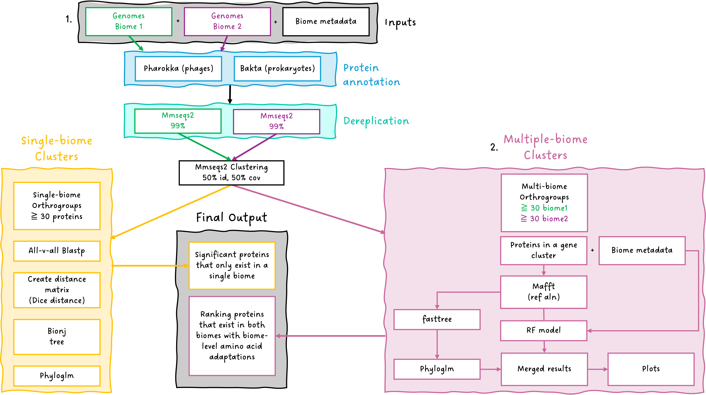

# XrAActor
This pipeline will help you identify which amino acid residues are important for the biome prediction of proteins

## Overall workflow

!workflow_image[]

## Running with proteins

### General process
Viral genomes + biome metadata --> gene calling --> clustering into orthogroups

## Running with genomes

### General process
