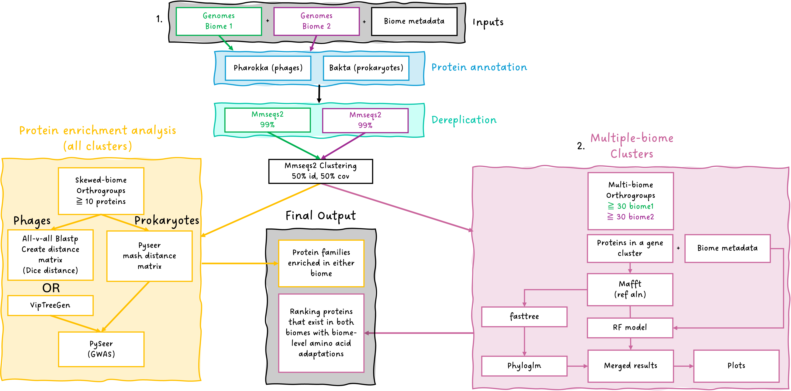

# XtrAActor
This nextflow pipeline will help you identify which proteins and amino acid residues are important for the biome prediction of proteins. That is to say - we can investigate how genomes and proteins are adapted to different environments or phenotypes through their amino acid adaptations.

You only need 2 "environments" + genomes or protein clusters/families
e.g.
biome1 = freshwater
biome2 = marine

the "environment" can also be a phenotype instead, for example, "disease" and "healthy"

**This pipeline is designed to be run with an HPC cluster like slurm** - change the `nextflow.config` file accordingly if using a different HPC or running locally (just ask your favourite Agent to do this)

## Overall workflow



The pipeline has two analyses that run side by side:

1. **Multi-biome clusters (amino acid level):** protein clusters with enough members in *both* biomes are aligned (MAFFT), a tree is built per cluster (FastTree2), a random forest learns which alignment positions + amino acids separate the biomes, and phyloglm tests each of these features against the cluster tree.
2. **Protein enrichment (protein level, genome entry point only):** every protein cluster is tested for being enriched in one biome with [pyseer](https://pyseer.readthedocs.io), corrected for how related the genomes are. This also covers clusters that are found (almost) only in one biome and therefore cannot go through the analysis above.

## Installation (WIP)

### External programs used - stay tuned - I'm working on an easy way to get you all of these

You will require the following tools for running this pipeline and please make sure to cite them!

Pharokka:
Pharokka database:
Phold:
Bakta:
mmseqs2:
foldseek with gpu:
foldmason:
mafft:
phyloglm:
Fasttree2-MP:
pyseer:
mash:
ViPTreeGen (needs BLAST):
Diamond Blastp:

### conda environments required

There are two yml files included you can use to install all the python dependencies for both nextflow and for the scripts

```bash
conda env create -f XtAActor_env.yml
conda env create -f working-env-nf.yml
```

The R environment used for phyloglm (`--r_env`, default `phyloglm`) also needs the R packages `ape` and `phangorn` if you give your own genome tree (`--genome_tree`).

## Running the pipeline
There are two entry points to the pipeline

1. from genomes
2. from protein clusters

The sbatch file only starts the Nextflow head job, which submits and monitors all other jobs. It needs few resources (2 CPUs, 8 GB) but must run longer than the whole pipeline, so give it the longest time limit your cluster allows. Create the `tmp/` folder for its logs before submitting:

```bash
mkdir -p tmp
sbatch run_xtraactor_genomes.sbatch
```

### 1. Running with genomes

Create a new folder for your run, go into it, copy and edit the sbatch and run from there

```bash
mkdir my_run
cd my_run
cp ../run_xtraactor_genomes.sbatch ./

# create your input folders
mkdir -p data/fastas
mkdir -p data/metadata
```

How the genome fastas are laid out depends on `--genome_type`:

**Phages** (`--genome_type phage`, annotated with Pharokka): one multi-fasta **per biome**, one contig = one genome.
```bash
my_run/
├── data
│   ├── fastas
│   │   ├── marine.fna
│   │   └── freshwater.fna
│   └── metadata
│       └── freshwater_marine_metadata.tsv
```
The genome ID is the contig name (before the first whitespace and the first `|`).

**Bacteria / non-phage** (`--genome_type non-phage`, annotated with Bakta): one fasta **per genome**, any number of contigs.
```bash
my_run/
├── data
│   ├── fastas
│   │   ├── GCA_000009705.1_ASM970v1_genomic.fna
│   │   ├── GCA_000009725.1_ASM972v1_genomic.fna
│   │   └── ...
│   └── metadata
│       └── metadata.tsv
```
The genome ID is the file name without `.fna`. The genomes are grouped per biome using the metadata file.

The metadata file has a header line and one row per genome: genome ID, whitespace, biome. Biome names may contain spaces.
```
genome	biome
GCA_000009705.1_ASM970v1_genomic	Freshwater
GCA_000210375.1_ASM21037v1_genomic	Non-marine Saline and Alkaline
```

See the examples folder for what these files should look like.
[data/fastas](https://github.com/MGXlab/XtrAActor/tree/main/Examples/input_examples/from_genomes/data/fastas)
[data/metadata](https://github.com/MGXlab/XtrAActor/tree/main/Examples/input_examples/from_genomes/data/metadata)

Change the parameters in the sbatch file accordingly. You will need to change the paths for the inputs etc

Required params:

```bash
  --entry_point 'genome'
  --genome_dir path/to/data/fastas
  --metadata_file path/to/data/metadata/metadata.tsv
  --genome_type phage                              # or non-phage
  --biome1 "Environmental;Aquatic;Freshwater"      # please make sure this matches whatever is in your metadata.tsv
  --biome2 "Environmental;Aquatic;Marine"
  --colour1 "#91ff00"
  --colour2 "#ff7f0e"               # colour1 and 2 are for biome1 and 2, for all the plots
  --out_dir results_out             # anyway it is the default
```

`--biome1` / `--biome2` match a metadata biome if they are the full label or its last part after `;` (`Freshwater` matches `Environmental;Aquatic;Freshwater`). biome2 is coded as 1 in phyloglm and pyseer, so positive estimates mean "goes with biome2".

#### Re-using the proteins of an earlier run

If one biome was already annotated and dereplicated in an earlier run, give that run's `mmseq2_derep` folder instead of its genomes:

```bash
  --precomputed_proteins path/to/earlier_run/results_out/mmseq2_derep
```

The folder must contain `<biome>_derep_rep_seq.fasta` and `<biome>_derep_cluster.tsv`. For the protein enrichment the pipeline also looks for that biome's full protein set (`annotation/*/<biome>_proteins.faa`) in this run's `--out_dir` and next to the `mmseq2_derep` folder. With `--enrich_distances viptreegen` or `mash` it also needs the genomes of that biome (`--precomputed_genomes`).

### 2. Running with protein clusters

Create a new folder for your run, go into it, copy and edit the sbatch and run from there

```bash
mkdir my_run
cd my_run
cp ../run_xtraactor_genomes.sbatch ./

# create your input folders (in this case, you'll also create the main output folder)
mkdir -p results_out/cluster_biomes
mkdir -p results_out/cluster_fastas
```

Your input should be formatted like this directly in the `results_out` directory:

```bash
├── results_out
│   ├── cluster_biomes
│   │   ├── cluster_1022537_biome.tsv
│   │   ├── cluster_1331451_biome.tsv
│   ├── cluster_fastas
│   │   ├── cluster_1022537.fasta
│   │   ├── cluster_1331451.fasta
```
See the examples folder for what these files should look like.

[cluster_fastas](https://github.com/MGXlab/XtrAActor/tree/main/Examples/input_examples/from_protein_clusters/results_out/cluster_fastas)
[cluster_biomes](https://github.com/MGXlab/XtrAActor/tree/main/Examples/input_examples/from_protein_clusters/results_out/cluster_biomes)

Change the parameters in the sbatch file accordingly. You will need to change the paths for the inputs etc

Required params:

```bash
  --entry_point 'clusters'
  --metadata_dir results_out/cluster_biomes
  --fasta_dir results_out/cluster_fastas
  --biome1 "Environmental;Aquatic;Freshwater"      # please make sure this matches whatever is in your metadata.tsv
  --biome2 "Environmental;Aquatic;Marine"
  --colour1 "#91ff00"
  --colour2 "#ff7f0e"                         # colour1 and 2 are for biome1 and 2, for all the plots
  --out_dir results_out                       # anyway it is the default
```

The protein enrichment analysis needs genomes, so it only runs with the genome entry point.

## Which clusters go where

After clustering all proteins (MMseqs2, `--id` / `--cov`):

* **Multi-biome analysis (RF + phyloglm):** clusters with at least 20 proteins in *each* biome. The number is `MIN_PER_BIOME` at the top of `bin/orthogroups_sel_by_biome.py`.
* **Protein enrichment (pyseer):** all clusters with at least `--enrich_min_proteins` proteins (default 10), including the ones in the multi-biome analysis. The report flags which clusters are single-biome and which also went through the multi-biome analysis.

## Protein enrichment with pyseer

For each protein cluster, pyseer tests whether carrying the cluster predicts a genome's biome beyond what the genome's relatedness already predicts. The relatedness of the genomes comes from one of:

| Option | Used for | pyseer model |
|---|---|---|
| `--genome_tree my_tree.nwk` | your own tree of all genomes (tip labels = genome IDs; unrooted trees are midpoint-rooted) | linear mixed model |
| ViPTreeGen (default for phages) | genome-wide tBLASTx similarity, distance = 1 − SG score | fixed effects, distances reduced to MDS axes |
| mash (default for non-phage) | k-mer distances between genomes | fixed effects, MDS axes |
| `--enrich_distances dice` | all-v-all DIAMOND blastp of the predicted proteins → Dice distances | fixed effects, MDS axes |

**MDS dimensions (`--pyseer_max_dimensions`, default 10).** With a distance matrix, pyseer summarises the genome relatedness as a number of axes (like a PCA) and corrects for each genome's position on them. Too few axes correct only roughly; too many describe individual genomes and absorb the biome signal itself. With few genomes use few axes (e.g. 2–3 for a small test run). For real data, check the scree plot of the distance matrix (`scree_plot_pyseer`).

**Significance.** A cluster is significant when its p-value is below 0.05 divided by the number of distinct presence/absence patterns tested (clusters with identical patterns count once), as recommended by pyseer. A Benjamini-Hochberg padj is given for reference.

With very few genomes (e.g. 13), no cluster can reach significance; this analysis needs dozens to hundreds of genomes per biome.

## Outputs

```bash
results_out/
├── annotation/                     # Pharokka / Bakta per biome set or genome (+ by_biome/ for non-phage)
├── mmseq2_derep/                   # dereplicated proteins per biome (re-usable as --precomputed_proteins)
├── mmseq2/                         # 50/50 clustering of all proteins
├── cluster_fastas/ cluster_biomes/ # clusters selected for the multi-biome analysis
├── mafft/ fasttree/                # alignments and trees per cluster
├── RF_results/raw/                 # random forest per cluster
├── test_phyloglm/                  # phyloglm per cluster
├── cluster_ranking.tsv             # clusters ranked by feature stability (elbow overlap) and accuracy
├── plots/
│   ├── individual_cluster_plots/<cluster>/   # seq logos, enrichment bars, radars, protein analysis per cluster
│   └── overall_cluster_plots/                # RF report plots + protein property volcano plots across clusters
└── protein_enrichment/
    ├── enrichment_report.tsv       # significant clusters: enriched_in, beta, p-value, single_biome, in_rf_analysis
    ├── enrichment_all.tsv          # every tested cluster
    ├── enrichment_summary.txt      # counts
    ├── inputs/                     # phenotypes, cluster info
    └── structure/                  # logs of the distance / tree step
```

The per-cluster plots start as soon as that cluster's random forest has finished; the overall plots wait for all clusters. The protein enrichment runs in parallel with the multi-biome analysis.

## Welcome to parameter heaven

Run `nextflow run main.nf --help` for the full list with the current defaults. The main options:

```bash
    General:
        --entry_point          'genome' or 'clusters' (required)                  [null]
        --out_dir              Output directory                                   [output_dir_1]
        --help                 Print this help and exit

    Entry point 'genome':
        --genome_dir           phage: one multi-fasta per biome; non-phage: one fasta per genome
                               (*.fna, *.fa, *.fasta)                             [null]
        --metadata_file        Combined metadata table: genome ID <whitespace> biome, all biomes
                                                                                  [null]
        --precomputed_proteins mmseq2_derep folder of an earlier run: already dereplicated
                               proteins of other biomes                           [null]
        --genome_type          'phage' (Pharokka) or 'non-phage' (Bakta) (required)
                                                                                  [null]
        --gene_predictor       Phage only: 'phanotate', 'prodigal' or 'prodigal-gv'
                                                                                  [prodigal-gv]
        --pharokka_db          Pharokka database directory                        [path/to/pharokka_db]
        --pharokka_args        Extra Pharokka arguments        [--meta --skip_extra_annotations --skip_mash]
        --bakta_db             Bakta database directory                         [path/to/bakta/v20240516/db]
        --bakta_args           Extra Bakta arguments                              [--skip-plot --gram -]
        --dereplicate          Dereplicate proteins within each biome first       [true]
        --derep_id             Dereplication min. sequence identity (fraction)    [0.99]
        --derep_cov            Dereplication coverage (fraction)                  [0.9]
        --id                   MMseqs2 clustering min. sequence identity (fraction)
                                                                                  [0.5]
        --cov                  MMseqs2 clustering coverage (fraction)             [0.5]

    Entry point 'clusters':
        --fasta_dir            Per-cluster fasta files (<cluster>.faa or .fasta)  [null]
        --metadata_dir         Per-cluster tables (<cluster>_biome.tsv or <cluster>_metadata.tsv)
                                                                                  [metadata]

    Downstream analysis:
        --biome1 / --biome2    Biome labels: full label or the part after the last ';' (required)
                                                                                  [null / null]
        --colour1 / --colour2  Plot colours for biome1 / biome2 (required)       [null / null]
        --min_seqs             Skip clusters with fewer sequences                 [4]
        --do_trimal            Run trimAl on the MAFFT alignments                 [false]
        --n_chunks             Max phyloglm chunks per cluster                    [15]

    Protein enrichment with pyseer (entry point 'genome' only):
        --enrichment           Run the protein enrichment analysis                [true]
        --enrich_min_proteins  Test clusters with at least this many proteins     [10]
        --genome_tree          Newick tree of all genomes (tips = genome IDs);
                               used instead of distances, with pyseer mixed model [null]
        --enrich_distances     Without a tree: 'viptreegen', 'mash' or 'dice'
                                                     [phage: viptreegen, non-phage: mash]
        --precomputed_genomes  Genomes of the --precomputed_proteins biome(s), for viptreegen / mash
                                                                                  [null]
        --pyseer_min_af / --pyseer_max_af   pyseer frequency filter              [0.01 / 0.99]
        --pyseer_max_dimensions  MDS axes of the distance matrix                  [10]
        --pyseer_args          Extra pyseer arguments                             []
        --enrich_alpha         Significance level                                 [0.05]
        --mash_sketch_size     mash sketch -s                                     [10000]
        --diamond_evalue / --diamond_pident   Dice only: blastp e-value / min. identity
                                                                                  [1e-5 / 40]
        --dice_evalue / --dice_pident / --dice_args   Dice only: hit filters      [1e-5 / 40 / none]

    Tools and environments (usually left at their defaults):
        --mafft_bin            []
        --trimal_bin           []
        --fasttree_bin         []
        --diamond_bin          []
        --viptreegen_bin       []
        --viptreegen_conda_sh  []
        --viptreegen_env       [ViPTreeGen_v1.1.3]
        --viptreegen_blast_dir []
        --conda_sh_veo         []
        --conda_sh_lydia       []
        --conda_sh_ri          []
        --pharokka_env         [pharokka]
        --bakta_env            [bakta_v1.9.3]
        --pyseer_env           [pyseer]
        --r_env                [phyloglm]
        --shared_bin           []

    Values in [brackets] are the current defaults (null = not set).
    Resources (cpus, memory, time, partitions) are set per process in nextflow.config.
```